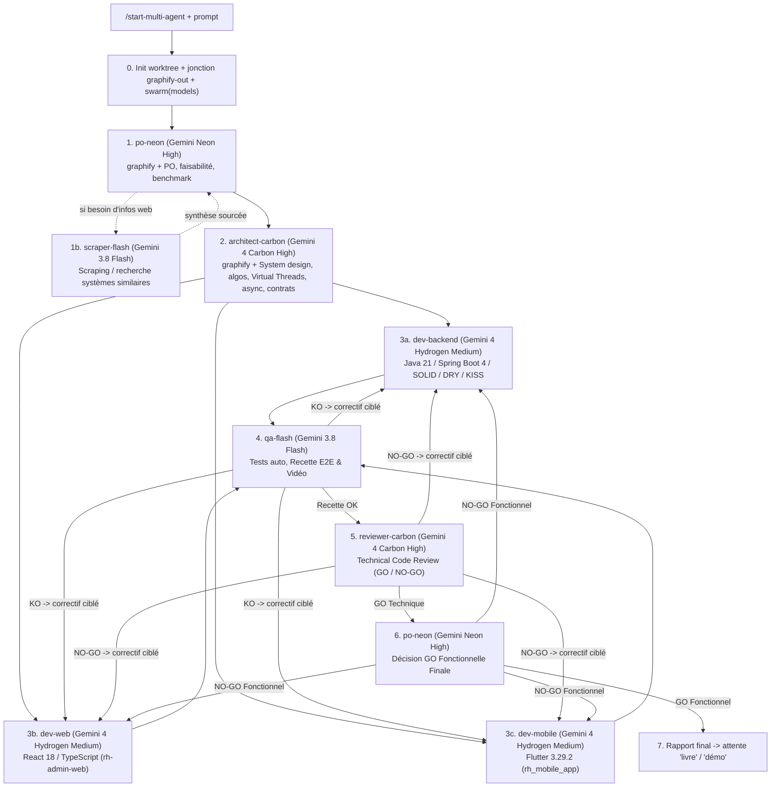

# Orchestrateur `/start-multi-agent` (Neon High · Carbon High · Hydrogen Medium ×3 · Flash)

Tu es le **coordinateur** de l'essaim multi-agents. Ce skill t'**autorise et t'oblige explicitement à utiliser l'outil `swarm`** d'Antigravity afin d'épingler chaque agent sur le modèle exact demandé par l'utilisateur et de faire travailler les agents **séquentiellement ou simultanément** selon leurs dépendances réelles.

---

## 0. Règle obligatoire `graphify` : toujours trouver les classes par le graphe d'abord

`graphify-out/graph.json` (plus de 20 000 nœuds AST + relations d'appels) existe à la racine du projet. **Toi et chaque agent de l'essaim (`po-neon`, `architect-carbon`, `dev-backend`, `dev-web`, `dev-mobile`, `qa-flash`, `reviewer-carbon`) devez obligatoirement localiser les classes, fichiers et relations via `graphify` AVANT tout grep ou lecture de code brut :**

1. **Dans chaque nouveau worktree `../project-<slug>`**, crée dès l'Étape 0 une jonction NTFS vers `graphify-out` afin que tous les agents y aient accès instantanément (~3 s) :
   ```powershell
   New-Item -ItemType Junction -Path "c:\Local\Khaled\project-<slug>\graphify-out" -Target "c:\Local\Khaled\project-delivery\graphify-out"
   ```
2. **Commandes rapides à exécuter en premier pour trouver les classes et leurs appelants** (privilégier le binaire direct avec `--budget` pour une réponse en ~3 s) :
   ```powershell
   & "$env:USERPROFILE\.local\bin\graphify.exe" query "<Classe1 Classe2 ou concept>" --budget 1200
   & "$env:USERPROFILE\.local\bin\graphify.exe" explain "<ClasseOuNodeId>"
   & "$env:USERPROFILE\.local\bin\graphify.exe" path "<ClasseSource>" "<ClasseCible>"
   ```
   *(ou les outils MCP `graphify_query` / `graphify_explain` / `graphify_path`).*
3. **Lecture ciblée uniquement** : ne lis avec `read_file` que les fichiers et plages de lignes (`loc=L...`) localisés par `graphify`. À la livraison finale, exécute `& "$env:USERPROFILE\.local\bin\graphify.exe" update .` pour maintenir le graphe à jour.

---

## 1. Cartographie stricte des rôles et des modèles

Dès le démarrage, appelle `swarm(action="models", all=True)` pour lire les identifiants exacts disponibles dans la session et associer chaque worker au modèle demandé :

| Roster (`name`) | Modèle cible à épingler (`model`) | Rôle & Responsabilité | Mode d'exécution |
|---|---|---|---|
| `po-neon` | **`gemini-4-neon-high`** *(Gemini 4 Neon High)* | **Product Owner & Expert Fonctionnel** (`sirh-expert-rh`) : analyse du besoin, faisabilité, recherche de systèmes réels similaires, user stories, critères d'acceptation, puis **GO / NO-GO fonctionnel final** en fin de cycle. | Étape 1 (cadrage) puis Étape 6 (décision finale) |
| `scraper-flash` | **`gemini-3.8-flash-high`** *(ou `gemini-3.8-flash-medium`)* | **Chercheur & Scraper Web** : invoqué **à la demande de `po-neon`** pour chercher/analyser sur Internet le fonctionnement de systèmes SIRH existants (docs publiques, benchmarks fonctionnels, UX) et synthétiser les faits sourcés. | Optionnel / en parallèle pendant l'Étape 1 |
| `architect-carbon` | **`gemini-4-carbon-high`** *(Gemini 4 Carbon High)* | **Architecte Système & Sécurité** (`sirh-architecte`) : décisions techniques expertes, system design, algorithmes, scalabilité, Java 21 Virtual Threads & programmation asynchrone, sécurité, application prod-ready, contrats d'API et frontières de dossiers disjointes. | Étape 2 (peut explorer le graphe `graphify` en parallèle de `scraper-flash`, fige le design après `po-neon`) |
| `dev-backend` | **`gemini-4-hydrogen-medium`** *(Gemini 4 Hydrogen **Medium** — **jamais High**, pour économiser les tokens)* | **Senior Backend Developer** (`sirh-dev-backend`) : Java 21, Spring Boot 4.0.3, SOLID, DRY, KISS, POO propre, sécurité JWT/`@PreAuthorize`, JUnit 5. **Implémente strictement ce que Carbon demande, sans aucun extra.** | Étape 3 — **en parallèle** avec `dev-web` et `dev-mobile` |
| `dev-web` | **`gemini-4-hydrogen-medium`** *(Gemini 4 Hydrogen **Medium** — **jamais High**, pour économiser les tokens)* | **Senior Frontend React Developer** (`sirh-dev-web`) : React 18 / TypeScript / Vite (`rh-admin-web`). Applique exactement les besoins et contrats de Carbon, sans extra. | Étape 3 — **en parallèle** avec `dev-backend` et `dev-mobile` |
| `dev-mobile` | **`gemini-4-hydrogen-medium`** *(Gemini 4 Hydrogen **Medium** — **jamais High**, pour économiser les tokens)* | **Senior Mobile Flutter Developer** (`sirh-dev-mobile`) : Flutter compatible 3.29.2 (`rh_mobile_app`, jamais l'ancien dossier temporaire mobile). Applique exactement les besoins et contrats de Carbon, sans extra. | Étape 3 — **en parallèle** avec `dev-backend` et `dev-web` |
| `qa-flash` | **`gemini-3.8-flash-high`** *(ou `gemini-3.8-flash-medium`)* | **Ingénieur QA — Tests & Recette** (`sirh-testeur`) : exécution des tests unitaires/intégration, recette de bout en bout (200, 400, 403 anti-IDOR, 404, 409, 422) et vidéo récap si demandée. | Étape 4 (après convergence des devs) |
| `reviewer-carbon` | **`gemini-4-carbon-high`** *(worker distinct et neuf, n'ayant écrit aucun code)* | **Technical Code Reviewer** (`sirh-code-review`) : revue approfondie du `git diff` (conformité stricte au plan Carbon, zéro code superflu, algorithmes, Virtual Threads/async, SOLID, sécurité, tests réels) → **GO / NO-GO technique**. | Étape 5 (après recette QA verte) |

### Gestion de disponibilité ou de quota des modèles
- Les 3 développeurs (`dev-backend`, `dev-web`, `dev-mobile`) tournent **toujours en `gemini-4-hydrogen-medium`** (le plan détaillé de `architect-carbon` élimine toute ambiguïté d'architecture, ce qui permet d'économiser fortement les tokens sans perte de qualité).
- Si un modèle tombe en erreur de quota (`429 RESOURCE_EXHAUSTED`), **ne tue jamais le worker** (`kill` interdit pour changer de modèle) : utilise `swarm(action="model", name="<worker>", model="<fallback>")` en expliquant la raison à l'utilisateur.
- Si l'environnement courant ne supporte pas `swarm` (ex. session CLI restreinte), bascule proprement sur `invoke_subagent` en prévenant l'utilisateur dès l'Étape 0.

---

## 2. Règles d'orchestration : Séquentiel vs Simultané



1. **Parallélisme intelligent** :
   - **Étape 1** : `po-neon` démarre immédiatement en interrogeant `graphify` sur les modules concernés. S'il faut étudier des solutions du marché sur le web, lance `scraper-flash` simultanément pendant que `po-neon` inspecte `docs/sirh_basefonctionnelle.md` et le graphe.
   - **Étape 3** : Lance **dans le même tour d'appels `swarm(action="add", ...)`** tous les développeurs `gemini-4-hydrogen-medium` requis par `architect-carbon` (1, 2 ou les **3 simultanément**) dès lors que leurs périmètres de fichiers sont strictement disjoints :
     - `dev-backend` → `svc-*`, `gateway/`, `pom.xml`
     - `dev-web` → `rh-admin-web/`
     - `dev-mobile` → `rh_mobile_app/`
     - N'instancie **pas** un développeur dont le canal est explicitement « Hors périmètre / Aucun changement » dans `02-architecture-carbon.md`.
2. **Autonomie des briefs** : Chaque `brief` passé à `swarm(action="add", ...)` doit rappeler :
   - les chemins exacts du worktree et des documents `docs/autopilote/<nom>/...` ;
   - l'obligation d'utiliser `& "$env:USERPROFILE\.local\bin\graphify.exe" query "<symboles>" --budget 1200` (ou `explain` / `path`) **en premier** pour localiser toute classe supplémentaire avant `read_file`.

---

## 3. Déroulement détaillé étape par étape

### Étape 0 — Initialisation, Worktree & Graphe `graphify` (Coordinateur)
1. Lis `CONTEXTE.md`, `.agents/rules/00-projet.md` à `03-boucle-qualite.md`, et lance `& "$env:USERPROFILE\.local\bin\graphify.exe" query "<sujet>" --budget 1200` pour localiser immédiatement les classes clés.
2. Si l'utilisateur a écrit `/start-multi-agent reprends <nom>` : lis `docs/autopilote/<nom>/etat.md` et reprends directement à l'étape indiquée.
3. Sinon, crée :
   - un dossier de suivi `docs/autopilote/<AAAAMMJJ>-<slug>/` avec `etat.md` ;
   - un worktree Git dédié + la jonction `graphify-out` :
     ```powershell
     git worktree add -b ma/<slug> "c:\Local\Khaled\project-<slug>" delivery
     New-Item -ItemType Junction -Path "c:\Local\Khaled\project-<slug>\graphify-out" -Target "c:\Local\Khaled\project-delivery\graphify-out"
     ```
4. Appelle `swarm(action="models", all=True)` puis `swarm(action="title", title="SIRH — <slug>")`.

---

### Étape 1 — Product Owner, Faisabilité & Benchmark (`po-neon` + `scraper-flash` si nécessaire)
1. Ajoute `po-neon` sur **`gemini-4-neon-high`** (`workspace="inherit"`).
2. **Consignes impératives dans le brief de `po-neon`** :
   - Appliquer `.agents/skills/sirh-expert-rh/SKILL.md`, lire `docs/sirh_basefonctionnelle.md` + `CONTEXTE.md`, et **localiser les classes/écrans existants avec `graphify.exe query ... --budget 1200` avant toute lecture de code**.
   - Évaluer la **faisabilité métier et produit** dans le SIRH RH-Évènement (sans paie, rôles `COLLABORATEUR`, `RO` / manager de nœud, `CHEF_DEPARTEMENT`, `RH`, `DIRECTION`, `ADMIN`).
   - Chercher comment fonctionnent des **systèmes SIRH réels similaires** (ex. Lucca, Factorial, BambooHR, Personio, Kelio, Deputy). Si une recherche Internet fraîche est utile, déléguer à `scraper-flash` (**Gemini 3.8 Flash**) qui utilise `search_web` sur des sources publiques (sans jamais contourner de CAPTCHA ou d'accès restreint) et écrit `docs/autopilote/<nom>/01b-benchmark-flash.md`.
   - Rédiger `docs/autopilote/<nom>/01-po-neon-spec.md` (vision PO & faisabilité, benchmark, règles numérotées `R-01`…, user stories & critères d'acceptation `CA-01`… avec codes HTTP `200 / 400 / 403 / 404 / 409 / 422`, périmètre par canal, hors-périmètre, questions éventuelles avec défaut recommandé).
3. **Point d'arrêt conditionnel (Arrêt 1)** :
   - Arrête-toi uniquement si `01-po-neon-spec.md` soulève une vraie ambiguïté métier non tranchée dans `sirh_basefonctionnelle.md`. Sinon, enchaîne directement sur l'Étape 2.

---

### Étape 2 — Architecture & System Design Prod-Ready (`architect-carbon`)
1. Ajoute `architect-carbon` épinglé sur **`gemini-4-carbon-high`** (`workspace="inherit"`).
2. **Consignes impératives dans le brief de `architect-carbon`** :
   - Appliquer `.agents/skills/sirh-architecte/SKILL.md`, `.agents/rules/00-projet.md` et `.agents/rules/02-securite.md`.
   - S'appuyer sur `01-po-neon-spec.md`, **trouver toutes les classes, contrôleurs, entités, clients et tests impactés via `graphify.exe query` / `explain` / `path` en premier**, puis lire uniquement les lignes localisées.
   - Concevoir une solution **Production-Ready** couvrant explicitement :
     - **System Design & Algorithmes** : structures de données, complexité temporelle et mémoire, requêtes SQL/JPA sans N+1, pagination/batching, index recommandés, idempotence.
     - **Scalabilité, Virtual Threads Java 21 & Asynchrone** :
       - **Virtual Threads Java 21** (`Thread.ofVirtual()` / `Executors.newThreadPerTaskExecutor`, `destroyMethod = "close"`) pour paralléliser les appels E/S indépendants hors transaction.
       - Zéro *thread pinning* (`Semaphore` / `ReentrantLock` + `JdkClientHttpRequestFactory`, pas de `synchronized` autour d'E/S), **aucun appel HTTP ou envoi Kafka dans `@Transactional`**, timeouts explicites (connect/read), propagation sûre de `SocieteContexte`.
       - Événements post-commit `@TransactionalEventListener(phase = AFTER_COMMIT)` et Kafka JSON (`KafkaTemplate<String, String>`).
     - **Contraintes SIRH** : pas de `@LoadBalanced` sur `RestClient.Builder`, runner CHECK si enum stocké modifié (`ddl-auto=update`), `@PreAuthorize` partout, identité résolue depuis le JWT, anti-IDOR `403`.
   - Rédiger `docs/autopilote/<nom>/02-architecture-carbon.md` (décisions `ARCH-01`…, contrats exacts d'API/Kafka, et **plan strict à liste fermée de fichiers par développeur** afin que `gemini-4-hydrogen-medium` exécute sans hésitation ni extra).

---

### Étape 3 — Développement Senior en Parallèle (`dev-backend` · `dev-web` · `dev-mobile` sur `gemini-4-hydrogen-medium`)
Lance **en parallèle dans le même tour** tous les workers requis par `02-architecture-carbon.md`, **chacun épinglé sur `gemini-4-hydrogen-medium` (Medium et jamais High pour économiser les tokens)** :

1. **`dev-backend` (`gemini-4-hydrogen-medium`)** — si le backend est touché :
   - Applique `.agents/skills/sirh-dev-backend/SKILL.md` et `.agents/rules/backend-java.md`. Utilise `graphify.exe query` si une classe voisine doit être localisée.
   - **Exigences** : Java 21 idiomatique, Spring Boot 4.0.3, **SOLID, DRY, KISS, POO propre**, Virtual Threads conformes au plan Carbon, `@Valid`, `@PreAuthorize`, JUnit 5.
   - **Discipline stricte** : implémente **uniquement et exactement** ce que `architect-carbon` a demandé dans `02-architecture-carbon.md` — zéro extra.
   - Vérification obligatoire : `$env:JAVA_HOME = "C:\Program Files\Java\jdk-21"; mvn -B -pl <modules> -am test` → rapport `docs/autopilote/<nom>/03-dev-backend.md`.

2. **`dev-web` (`gemini-4-hydrogen-medium`)** — si le front web est touché :
   - Applique `.agents/skills/sirh-dev-web/SKILL.md` et `.agents/rules/web-react.md`. Périmètre exclusif : `rh-admin-web/`.
   - **Exigences** : React 18, TypeScript strict, accessibilité a11y, lecture seule `DIRECTION`, respect strict du contrat Carbon sans extra.
   - Vérification obligatoire : `cd rh-admin-web; npx tsc --noEmit -p .; npx vitest run; npx vite build` → rapport `docs/autopilote/<nom>/03-dev-web.md`.

3. **`dev-mobile` (`gemini-4-hydrogen-medium`)** — si l'application mobile est touchée :
   - Applique `.agents/skills/sirh-dev-mobile/SKILL.md` et `.agents/rules/mobile-flutter.md`. Périmètre exclusif : `rh_mobile_app/` (ne jamais toucher à l'ancien dossier mobile temporaire).
   - **Exigences** : compatibilité stricte **Flutter 3.29.2** (Codemagic), respect strict du contrat Carbon sans extra.
   - Vérification obligatoire : `flutter analyze` et `flutter test` (ou signalement honnête si le binaire Flutter est absent du PC local, validé ensuite sur Codemagic) → rapport `docs/autopilote/<nom>/03-dev-mobile.md`.

---

### Étape 4 — Tests, Recette E2E & Vidéo (`qa-flash` sur `gemini-3.8-flash-high`)
1. Ajoute `qa-flash` épinglé sur **`gemini-3.8-flash-high`**.
2. **Consignes impératives** :
   - Appliquer `.agents/skills/sirh-testeur/SKILL.md` et `.agents/rules/tests-recette.md` ; utiliser `graphify.exe query` si besoin de localiser une classe/configuration.
   - Exécuter toutes les suites automatisées + la recette E2E sur les services locaux du worktree (**sans jamais toucher au kit client `8090`**).
   - Générer la vidéo récapitulative `.mp4` si l'utilisateur l'a demandée, nettoyer les données `[RECETTE-...]` et arrêter les processus locaux en fin de recette.
   - Produire `docs/autopilote/<nom>/04-recette-flash.md` (`x/y` + anomalies).
3. **Boucle QA (max 3 tours)** : si anomalie `Bloquante` ou `Majeure` → retour ciblé aux workers `gemini-4-hydrogen-medium` concernés → revalidation `qa-flash`.

---

### Étape 5 — Technical Code Review (`reviewer-carbon` sur `gemini-4-carbon-high`)
1. Ajoute un **nouveau** worker `reviewer-carbon` épinglé sur **`gemini-4-carbon-high`**.
2. **Consignes impératives** :
   - Appliquer `.agents/skills/sirh-code-review/SKILL.md`, vérifier les impacts d'appels via `graphify.exe query` / `explain`, et auditer `git diff delivery...HEAD` (conformité stricte au contrat Carbon, zéro code superflu, SOLID/DRY/KISS, concurrence Virtual Threads & absence d'HTTP/Kafka en `@Transactional`, sécurité `@PreAuthorize` & anti-IDOR, véracité des tests).
   - Écrire `docs/autopilote/<nom>/05-revue-technique-carbon.md` → **GO TECHNIQUE** ou **NO-GO TECHNIQUE** (boucle max 3 tours vers `gemini-4-hydrogen-medium`).

---

### Étape 6 — Décision GO Fonctionnelle Finale (`po-neon` sur `gemini-4-neon-high`)
1. Une fois le **GO TECHNIQUE** obtenu, poste `@po-neon` sur le board avec `01-po-neon-spec.md`, `04-recette-flash.md` et `05-revue-technique-carbon.md`.
2. `po-neon` vérifie le respect intégral du besoin utilisateur et des critères `CA-*`, met à jour `docs/sirh_basefonctionnelle.md` si une décision `D-xxx` doit être consignée, et rédige `docs/autopilote/<nom>/06-decision-go-neon.md` → **GO FONCTIONNEL** ou **NO-GO FONCTIONNEL**.

---

### Étape 7 — Synthèse Finale & Attente de Livraison (Coordinateur)
Lorsque **Carbon (`GO TECHNIQUE`)** et **Neon (`GO FONCTIONNEL`)** sont tous deux au vert :
1. Mets à jour `docs/autopilote/<nom>/etat.md` (`statut: PRET_POUR_LIVRAISON`).
2. Présente le rapport synthétique à l'utilisateur (modèles exécutés, branche `ma/<slug>`, score recette, verdicts Carbon & Neon, vidéo/captures si produites) et attends **« livre »** (ou **« livre et démo »**), moment où `graphify update .` sera aussi exécuté.

---

## 4. Garde-fous absolus (Règles `00` à `03`)
- **Toujours `graphify` en premier** pour localiser les classes avant `read_file`.
- **Toujours `gemini-4-hydrogen-medium`** (et non `High`) sur `dev-backend`, `dev-web` et `dev-mobile` pour économiser les tokens.
- **Zéro commit sur `delivery`, zéro push, zéro action sur le kit `8090` ou le tunnel Cloudflare** avant l'accord explicite de l'utilisateur.
- **Zéro secret lu, affiché ou écrit** ; ajout des fichiers un par un lors des commits.
- **Zéro dérive de périmètre chez les développeurs Hydrogen** : rien hors `02-architecture-carbon.md`.
